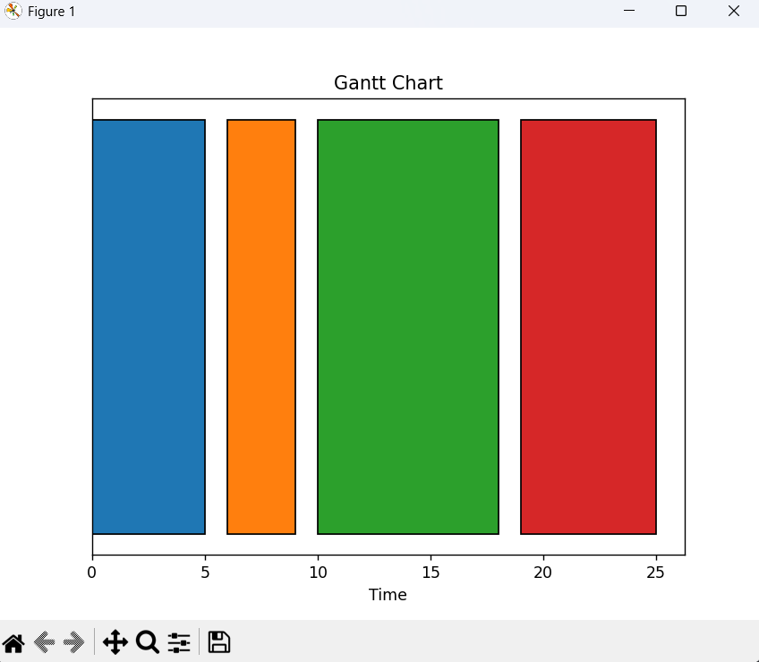
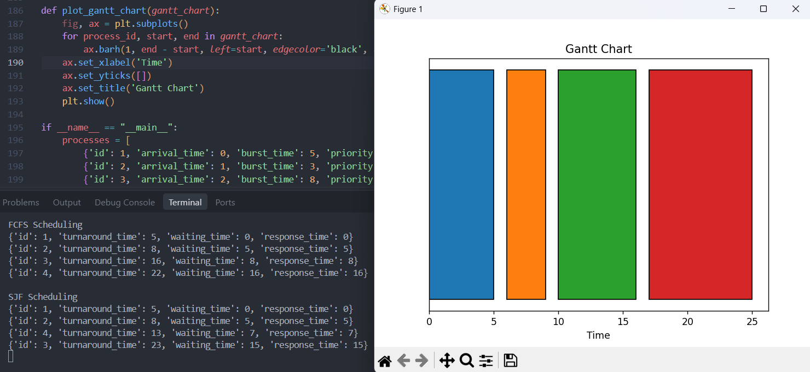
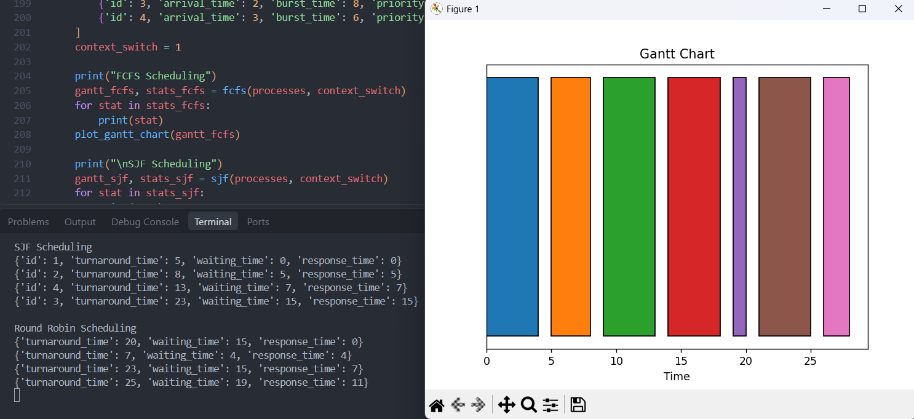
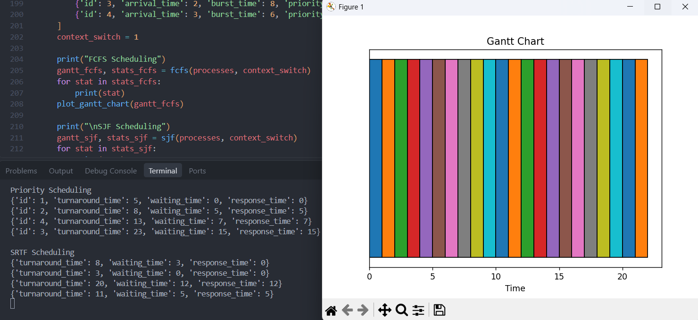

# CPU Process Scheduler Simulator

A Python-based simulation of classic **CPU Scheduling Algorithms** used in Operating Systems. This project visualizes process execution using **Gantt Charts** and calculates critical performance metrics such as Turnaround Time, Waiting Time, and Response Time.

> **📅 Project Timeline:** This project was originally developed and completed in **autumn 2024** (University Term 5) as part of my Computer Engineering coursework. It is uploaded here to document my continuous learning journey in Operating Systems and Algorithm Design.

## Implemented Algorithms

This simulator covers 5 fundamental CPU scheduling algorithms:

1. **FCFS (First-Come, First-Served):** The simplest non-preemptive algorithm.
2. **SJF (Shortest Job First):** Non-preemptive scheduling that selects the process with the shortest burst time.
3. **Round Robin (RR):** A preemptive algorithm using a time quantum, suitable for time-sharing systems.
4. **Priority Scheduling:** Non-preemptive scheduling based on process priorities.
5. **SRTF (Shortest Remaining Time First):** The preemptive version of SJF.

## Key Features

* **Context Switch Handling:** The simulation accurately accounts for the time wasted during context switching between processes.
* **Gantt Chart Visualization:** Uses `matplotlib` to visually represent the execution timeline of each algorithm.
* **Performance Metrics:** Automatically calculates and prints Waiting Time, Response Time, and Turnaround Time for every process.
* **Data Structures:** Utilizes Python's `heapq` (Min-Heap) for efficient priority queue management in SJF and Priority algorithms.

## Tech Stack

* **Python 3.x**
* **Matplotlib** (For Gantt Chart generation)

## How to Run

1. Clone the repository:
   **bash**

   ```
   git clone https://github.com/Awlishahnazi/CPU-Scheduler-Simulator.git
   ```
2. Navigate to the project directory:
   **bash**

   ```
   cd CPU-Scheduler-Simulator
   ```
3. Install the required dependencies:
   **bash**

   ```
   pip install -r requirements.txt
   ```
4. Run the simulation:
   **bash**

   ```
   python scheduling.py
   ```

## Output Preview

`Here are some screenshots demonstrating the simulation in action. The script prints detailed performance metrics (Waiting Time, Turnaround Time, etc.) to the terminal and visualizes the execution timeline using Matplotlib Gantt Charts.`

### 1. FCFS & SJF Simulation

The first image shows the output for **First-Come, First-Served (FCFS)** and The second one is for **Shortest Job First (SJF)**. You can see how processes are executed sequentially based on their arrival time and burst time.



### 2. Round Robin & Priority Simulation

These screenshots display the results for **Round Robin (RR)** (with a time quantum) and **Priority Scheduling**. Notice how the Gantt chart changes based on process priorities and time slicing.




### 3. SRTF (Preemptive SJF) Simulation

The **Shortest Remaining Time First (SRTF)** algorithm is preemptive, meaning a new process can interrupt an ongoing one if it has a shorter burst time. This results in a highly fragmented Gantt chart, as shown below.



## Author

**Ali Shahnazi Bejarsari**

* [GitHub Profile](https://github.com/Awlishahnazi)
* [LinkedIn](https://www.linkedin.com/in/ali-shahnazi-bejarsari-678bba342)
* [Personal Portfolio](https://alishahnazi.ir/)

<!--  <--## 👨‍💻 Author

**Ali Shahnazi Bejarsari**

* [GitHub Profile](https://github.com/Awlishahnazi)
* [LinkedIn](https://www.linkedin.com/in/ali-shahnazi-bejarsari-678bba342)
* [Personal Portfolio](https://alishahnazi.ir/)
